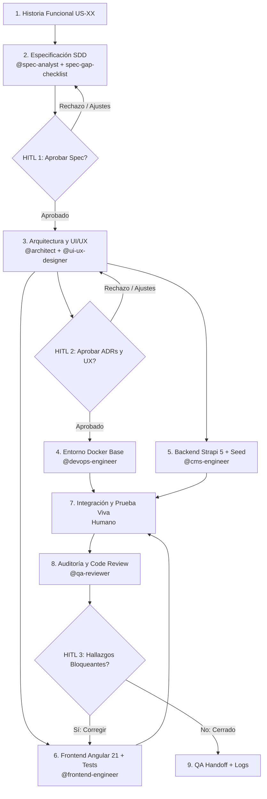

# FLOW.md — Flujo Agéntico (Historia Funcional → QA Handoff)

## Herramienta y Enfoque Elegidos
- **Herramienta:** **Claude Code (CLI)**, seleccionada por su soporte nativo de contexto global (`CLAUDE.md`), subagentes aislados con herramientas restringidas (`.claude/agents/`), skills reutilizables (`.claude/skills/`) y exportación íntegra de sesiones para auditoría.
- **Metodología:** **Spec-Driven Development (SDD) ligero propio**, en lugar de frameworks externos pesados (Spec Kit / Kiro), porque el alcance de 3 historias permite mantener artefactos Markdown versionados (`SPEC → ADR → CODE → TESTS → REVIEW`) transparentes y fáciles de auditar sin fricción de tooling adicional.

## Diagrama del Flujo

## Paso a Paso del Flujo

| Step | Description | AI used? | AI, agent, subagent or skill used | Deliverable produced | Human in the loop |
| :--- | :--- | :--- | :--- | :--- | :--- |
| **1. Triaje de Historia** | Revisión de reglas de negocio, criterios Gherkin y dependencias entre US-01, US-02 y US-03. | No | N/A | Orden de implementación y alcance del incremento | Tech Lead define prioridad (US-01 → US-02 → US-03) y valida restricciones de seguridad. |
| **2. Especificación (SDD)** | Detecta vacíos de la historia y construye una spec verificable con contratos y casos borde. | Sí | Claude Code (`sonnet`) — `@spec-analyst` + `spec-gap-checklist` | `docs/specs/SPEC-US-XX.md` | **HITL 1:** Revisa vacíos, reglas CO/CL y casos borde. Si falta rigor, rechaza y devuelve al analista. |
| **3. Arquitectura y ADRs** | Evalúa alternativas multi-país, seguridad de tokens y Docker; congela contratos TS/API. | Sí | Claude Code (`sonnet`) — `@architect` + `software-architecture-madr` | `docs/adrs/ADR-001.md`, `ADR-002.md` | **HITL 2:** Valida alternativas reales, consecuencias y ausencia de tokens de escritura en el cliente. |
| **4. Diseño UI/UX y Accesibilidad** | Define jerarquía visual, diseño responsive mobile/desktop, estados y flujo 100% teclado. | Sí | Claude Code (`sonnet`) — `@ui-ux-designer` + `ui-ux-accessibility-system` | `docs/specs/UI-UX-GUIDELINES.md` | Revisa claridad visual, contraste AA y accesibilidad antes de codificar vistas. |
| **5. Infraestructura Docker** | Configura `docker-compose.yml`, Dockerfiles, healthchecks y proxy Nginx `/api`. | Sí | Claude Code (`sonnet`) — `@devops-engineer` + `docker-single-command-ops` | `docker-compose.yml`, `Dockerfiles`, `nginx.conf` | Ejecuta `docker compose up --build` desde cero y verifica arranque limpio. |
| **6. Backend Strapi 5 + Seed** | Crea Content-Types, permisos mínimos de rol `Public` y seed idempotente para CO y CL. | Sí | Claude Code (`sonnet`) — `@cms-engineer` + `strapi-5-docker-seed` | `backend/` (schemas, `bootstrap.ts`) | Valida en Strapi Admin que los permisos públicos sean exclusivamente lectura (`find`). |
| **7. Frontend Angular 21 + Tests** | Implementa wizard de 3 pasos, formulario dinámico, signals, unit tests y E2E. | Sí | Claude Code (`sonnet`) — `@frontend-engineer` + `angular-21-dynamic-forms` | `frontend/` (componentes, servicios, `*.spec.ts`, `e2e/`) | Prueba manualmente navegación por teclado, responsive y escenario "nuevo campo sin deploy". |
| **8. Code Review Independiente** | Revisa código en modo solo lectura contra Spec, ADRs, seguridad y ejecuta la suite de tests. | Sí | Claude Code (`sonnet`) — `@qa-reviewer` + `qa-security-code-review` | `docs/reviews/REVIEW-US-XX.md` | **HITL 3:** Evalúa cada hallazgo (`BLOCKER`/`MAJOR`), exige fix y verifica cierre trazable. |
| **9. QA Handoff** | Recopilación de logs sin editar, trazabilidad completa y actualización de `README.md`. | No | N/A | `docs/logs/*`, `README.md`, `FLOW.md` | Aprobación final verificando cero credenciales reales y reproducibilidad con un comando. |

## Reflexiones Requeridas

### 1. ¿Qué cambiaría si un equipo de 5 desarrolladores utilizara este flujo?
- **CI/CD con puertas automáticas:** Un pipeline en GitHub Actions bloquearía cualquier PR sin referencia a `SPEC-US-XX`, sin tests unitarios/E2E en verde o que detecte secretos/tokens de Strapi en `frontend/`.
- **Revisión humana cruzada (Peer HITL):** Quien opera el agente de implementación no aprobaría su propio HITL-1 ni HITL-3; otro desarrollador revisaría la Spec y los hallazgos de seguridad.
- **Paralelización por contrato congelado:** Tras aprobar HITL-2, los contratos TypeScript/OpenAPI quedarían congelados para permitir que desarrolladores distintos trabajen en paralelo en `backend/` y `frontend/` usando ramas por historia.
- **Gestión de cambios en Strapi:** Reemplazar el seed local por migraciones versionadas o `strapi config:sync` sobre una instancia PostgreSQL compartida en staging.

### 2. ¿Qué parte del flujo no funcionó como se esperaba y cómo se ajustó?
> **[COMPLETAR CON EVIDENCIA REAL DE TU EJECUCIÓN EN CLAUDE CODE]**
> *Registra aquí un desvío real detectado durante tus sesiones (por ejemplo: sintaxis de Strapi 4 en lugar de Strapi 5 Document Service API, validación incompleta de RUT chileno o pérdida de foco al validar con teclado), indica en qué log de `docs/logs/` aparece y qué ajuste hiciste en la skill o subagente para corregirlo.*

### 3. ¿En qué puntos decidí NO usar IA y por qué?
- **Priorización y alcance (Paso 1):** La secuencia de entrega y los compromisos de negocio son responsabilidad humana.
- **Validación de seguridad y permisos en vivo (HITL 2 y Paso 6):** Nunca se confía únicamente en una afirmación del modelo para certificar que no existen tokens de escritura o permisos excesivos en el rol `Public`.
- **Prueba real de "cambio sin deploy" y accesibilidad manual (Paso 7):** Confirmar que un editor no técnico puede publicar un campo nuevo en Strapi y verlo al recargar Angular, así como sentir la fluidez real navegando solo con teclado, requiere prueba humana directa.
