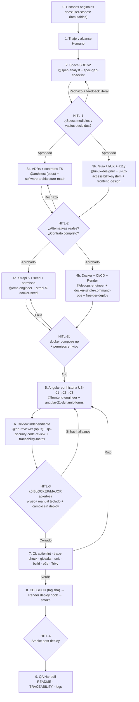

# FLOW.md — Flujo Agéntico (Historia Funcional → QA Handoff → Producción)

## Herramienta y enfoque
- **Herramienta:** **Claude (agente sobre Claude Agent SDK / Claude Code)**. La sesión principal (modelo Opus) actúa como **Orquestador** y despacha **subagentes aislados** cuyas definiciones viven en `.claude/agents/*.md` (instrucciones, herramientas permitidas, modelo, entradas y salidas). Las mismas definiciones son compatibles 1:1 con **Claude Code CLI**, de modo que un equipo puede reproducir el flujo en su terminal (`docs/PROMPTS-EJECUCION.md`).
  - *Por qué:* contexto global nativo (`CLAUDE.md`), subagentes con herramientas restringidas (p. ej. `@qa-reviewer` sin `Edit`), skills versionadas (`.claude/skills/`), permisos declarativos (`.claude/settings.json`) y ejecución real de comandos (tests, builds) para que la verificación no sea "afirmada" por el modelo.
  - *Modelos:* implementadores en `sonnet`; `@architect` y `@qa-reviewer` en `opus` para que quien revisa no comparta el mismo modelo que quien implementa.
- **Metodología:** **SDD ligero propio** en Markdown versionado (`US → SPEC → ADR → CODE → TESTS → REVIEW`), con IDs (`R-`, `AC-`, `GAP-`, `F-`) que un script (`scripts/trace-check.mjs`) verifica en CI. Se descartó Spec Kit/Kiro: para 3 historias añaden tooling y plantillas que no aportan sobre lo que el evaluador necesita auditar, y nuestra variante hace la trazabilidad **ejecutable**, que es lo que esos frameworks no garantizan por sí solos.

## Diagrama

## Paso a paso

| Step | Description | AI used? | AI, agent, subagent or skill used | Deliverable produced | Human in the loop |
| :--- | :--- | :--- | :--- | :--- | :--- |
| **0. Entrada inmutable** | Se copian las historias del PDF sin editar para que la spec siempre pueda contrastarse con el origen. | No | — | `docs/user-stories/US-0{1,2,3}.md` | Humano verifica que el texto es el original. `settings.json` prohíbe a los agentes editarlas. |
| **1. Triaje y mejora del kit** | Se evalúa el kit agéntico propuesto, se detectan vacíos (acoplamiento por `key`, JSON no editable por negocio, logs) y se aprueban mejoras. | Sí | Orquestador (Claude Opus) | Commit `chore(agentic)…`, `CLAUDE.md` v2 | **HITL-0:** el humano aprueba las mejoras propuestas en chat (log `docs/logs/00-orquestador-*.md`). |
| **2. Especificación SDD** | Reescribe cada spec con `GAP-`/`R-`/`AC-`, contratos, estados y matriz de verificación. | Sí | `@spec-analyst` (sonnet) + `spec-gap-checklist` | `docs/specs/SPEC-US-XX.md` v2 | **HITL-1:** el humano decide los `GAP` marcados como "decisión humana", corrige y aprueba. Rechazo → re-despacho con feedback literal y `Changelog`. Registro: `docs/hitl/HITL-1-specs.md`. |
| **3a. Arquitectura** | ADRs MADR con ≥ 3 alternativas reales y fuentes; contrato TS único. | Sí | `@architect` (opus) + `software-architecture-madr` | `docs/adrs/ADR-00{1,2,3}`, `docs/contracts/strapi-contracts.ts` | **HITL-2:** valida alternativas, consecuencias, permisos públicos. |
| **3b. UI/UX** | Tokens, layout por paso, estados, orden de foco, matriz WCAG 2.2 AA. | Sí | `@ui-ux-designer` (sonnet) + `ui-ux-accessibility-system` + `frontend-design` | `docs/specs/UI-UX-GUIDELINES.md` | **HITL-2:** revisa claridad visual y contraste. |
| **4a. Backend Strapi** | Content-types con componentes, `semanticRole`, lifecycles, seed idempotente no destructivo, permisos Public, BD por entorno. | Sí | `@cms-engineer` (sonnet) + `strapi-5-docker-seed` | `backend/` | **HITL-2b:** el humano entra al admin y verifica que Public solo tenga `find`. |
| **4b. Plataforma** | Compose de un comando, imágenes multi-stage no-root, Nginx 12-factor, CI/CD, Blueprint Render. | Sí | `@devops-engineer` (sonnet) + `docker-single-command-ops` + `free-tier-deploy` | `docker-compose.yml`, `Dockerfile`s, `.github/`, `render.yaml`, `docs/DEPLOY.md` | **HITL-2b:** `docker compose down -v && docker compose up --build` en la máquina del humano (el entorno del agente no tiene daemon Docker). |
| **5. Frontend** | Wizard por historia, funciones puras con tests titulados por ID, E2E Playwright. | Sí | `@frontend-engineer` (sonnet) + `angular-21-dynamic-forms` | `frontend/` | Humano prueba teclado, responsive y "nuevo campo sin deploy". |
| **6. Review** | Auditoría de solo lectura contra la spec aprobada, ejecución real de la suite, hallazgos `F-` con cierre trazable. | Sí | `@qa-reviewer` (opus) + `qa-security-code-review` + `traceability-matrix` | `docs/reviews/REVIEW-*.md`, `docs/TRACEABILITY.md` | **HITL-3:** prioriza hallazgos, exige fix o acepta con motivo. |
| **7. CI** | Puertas automáticas que bloquean el merge. | No (determinista) | GitHub Actions | Checks del PR | Branch protection + CODEOWNERS en rutas de gobierno. |
| **8. CD** | Publica imágenes inmutables y despliega por tag. | No (determinista) | GitHub Actions + GHCR + Render | URL pública | **HITL-4:** smoke post-deploy; *environment* `production` permite aprobación manual. |
| **9. Handoff a QA** | Matriz de trazabilidad, README, logs. | Parcial | Orquestador | `README.md`, `docs/logs/*` | Aprobación final: cero credenciales reales, reproducible con un comando. |

## Reflexiones requeridas

### 1. ¿Qué cambiaría con un equipo de 5 desarrolladores?
- **HITL cruzado:** quien opera un agente implementador no aprueba su propio HITL-1/HITL-3; CODEOWNERS ya obliga revisión humana en `docs/specs`, `docs/adrs`, `.claude/`.
- **Contrato congelado como paralelización:** tras HITL-2, `docs/contracts/strapi-contracts.ts` se versiona y backend/frontend avanzan en ramas por historia; un cambio de contrato exige un ADR nuevo.
- **Una spec por PR y entornos de preview:** cada PR levanta su stack (preview de Render vía API o `docker compose` en CI) y adjunta el reporte de Playwright.
- **Contenido Strapi gestionado como código:** migraciones/`strapi transfer` hacia un staging compartido en lugar de seeds locales; el seed queda solo para desarrollo.
- **Skills como producto del equipo:** cambios a `.claude/skills/` pasan por PR con ejemplos antes/después, porque alteran el comportamiento de todos los agentes.

### 2. ¿Qué parte del flujo no funcionó como se esperaba y cómo se ajustó?
> *Se completa con evidencia real al cierre (con referencia al log en `docs/logs/`).* Ajustes ya realizados en la fase de triaje:
- El kit original enlazaba precio y máscara a `key`s concretos: un cambio de negocio en Strapi rompía la app en silencio → se introdujo `semanticRole` (regla 3 de `CLAUDE.md`).
- El entorno del agente no tiene daemon Docker ni permite ejecutar binarios descargados (actionlint) → la verificación de contenedores pasó a HITL-2b humano + job `e2e` del CI, y actionlint a un paso del CI.
- **Consecuencia real de lo anterior:** sin actionlint local, el primer push dejó un `ci.yml` **inválido** (`hashFiles()` en el `if:` de nivel de job, solo permitido dentro de pasos). GitHub rechazó el workflow y fallaron también los 8 PRs que Dependabot abrió de inmediato. El humano lo detectó en la pestaña Actions y lo trajo con capturas. Ajuste: job `detect` con *outputs*, scripts sin patrones que shellcheck marque, actionlint desde su imagen oficial como **primer** paso del CI, y política de Dependabot agrupada que ignora saltos de *major* de Node/Angular/Strapi (Node 26 no es LTS). Lección incorporada a `@devops-engineer`: todo YAML de CI que no pueda validarse localmente se declara "no verificado" en el Handoff y su primera ejecución remota es un checkpoint humano. Ver `docs/logs/00b-orquestador-ci-fix.md`.

### 3. ¿En qué puntos decidí NO usar IA y por qué?
- **Triaje y prioridad (paso 1) y decisiones de `GAP` de negocio (HITL-1):** son compromisos de producto, no inferencias.
- **Certificar seguridad en vivo (HITL-2b):** no se acepta la afirmación del modelo sobre permisos; se comprueba en el admin y con un `POST` anónimo.
- **CI/CD (pasos 7-8):** deliberadamente determinista. Un pipeline no debe "razonar": debe ser repetible y auditable.
- **Prueba de teclado y "cambio sin deploy":** la experiencia real de un editor no técnico y de un usuario de teclado requiere manos humanas.
