# FLOW.md — Flujo Agéntico (Historia Funcional → QA Handoff → Producción)

## Herramienta y enfoque
- **Herramienta:** **Claude** (agente construido sobre Claude Agent SDK / Claude Code), operado desde la app de Claude con un espacio de trabajo en la nube y acceso a la carpeta local del humano. La sesión principal (modelo Opus) actúa como **Orquestador** y despacha **subagentes nativos aislados** cuyas definiciones viven en `.claude/agents/*.md` (instrucciones, herramientas permitidas, modelo, entradas y salidas). Las mismas definiciones son compatibles 1:1 con **Claude Code CLI** (`docs/PROMPTS-EJECUCION.md`).
  - *Por qué:* contexto global nativo (`CLAUDE.md`), subagentes con herramientas restringidas que el entorno hace cumplir (p. ej. `@spec-analyst` intentó usar Bash y fue bloqueado — log 03), skills versionadas (`.claude/skills/`), permisos declarativos (`.claude/settings.json`) y ejecución real de comandos para que la verificación no sea "afirmada" por el modelo.
  - *Modelos:* implementadores y analistas en `sonnet`; `@architect` y `@qa-reviewer` en `opus`, para que quien revisa no comparta el modelo de quien implementa.
  - *Coste/alternativa:* no se usó ningún plan de pago adicional al de Claude; GitHub Actions, GHCR, Render Free y Neon Free son gratuitos.
- **Metodología:** **SDD ligero propio** en Markdown versionado (`US → SPEC → ADR → CODE → TESTS → REVIEW`), con IDs (`R-`, `AC-`, `GAP-`, `F-`) que `scripts/trace-check.mjs` verifica en CI. Se descartó Spec Kit/Kiro: para 3 historias añaden tooling y plantillas que no aportan a lo que se audita, y nuestra variante hace la trazabilidad **ejecutable** (la puerta bloqueó el CI mientras hubo hallazgos BLOCKER/MAJOR abiertos).

## Diagrama

```mermaid
flowchart TD
    US["0. Historias originales<br/>docs/user-stories/ (inmutables)"] --> TRI["1. Triaje y mejora del kit<br/>Orquestador + HITL-0"]
    TRI --> SPEC["2. Specs SDD v2 → v3<br/>@spec-analyst + spec-gap-checklist"]
    SPEC --> H1{"HITL-1<br/>¿Specs medibles?<br/>¿vacíos decididos?"}
    H1 -- "Aprobado con cambios<br/>(3 correcciones humanas)" --> SPEC
    H1 -- Aprobado --> ARCH["3a. ADRs + contrato TS<br/>@architect (opus)"]
    H1 -- Aprobado --> UX["3b. Guía UI/UX + a11y<br/>@ui-ux-designer"]
    ARCH --> H2{"HITL-2<br/>ADRs, contrato,<br/>guía UI/UX"}
    UX --> H2
    H2 -- Aprobado --> CMS["4a. Strapi 5 + seed + seguridad<br/>@cms-engineer"]
    H2 -- Aprobado --> OPS["4b. Docker + CI/CD + smoke<br/>@devops-engineer"]
    CMS --> INT["Prueba de integración<br/>Orquestador (Strapi real + Nginx + smoke)"]
    OPS --> INT
    INT -- "falso positivo" --> OPS
    INT --> H2b{"HITL-2b<br/>docker compose up<br/>en la máquina del humano"}
    H2b -- OK --> FE["5. Angular por historia<br/>US-01 → US-02 → US-03<br/>@frontend-engineer"]
    FE --> V["Verificación independiente<br/>Orquestador (lint, unit, build, E2E)"]
    V --> QA["6. Review independiente<br/>@qa-reviewer (opus)"]
    QA --> H3{"HITL-3<br/>triage de hallazgos"}
    H3 -- "Corregir" --> FIX["Ronda de correcciones<br/>4 subagentes en paralelo"]
    FIX --> V2["Verificación del Orquestador"] --> RE["Re-auditoría @qa-reviewer"]
    RE --> H3b{"HITL-3 parte 2<br/>pruebas manuales"}
    H3b --> CI["7. CI: actionlint · tsc contrato · trace-check · gitleaks ·<br/>unit · build · E2E SQLite y Postgres · smoke · Trivy"]
    CI -- Rojo --> FE
    CI -- Verde --> CD["8. CD: GHCR (tag sha) → Render → smoke post-deploy"]
    CD --> H4{"HITL-4<br/>verificación del despliegue"}
    H4 --> HANDOFF["9. QA Handoff<br/>README · TRACEABILITY · logs"]
```

## Paso a paso

| Step | Description | AI used? | AI, agent, subagent or skill used | Deliverable produced | Human in the loop |
| :--- | :--- | :--- | :--- | :--- | :--- |
| **0. Entrada inmutable** | Las historias del PDF se copian sin editar para contrastar siempre la spec con el origen. | No | — | `docs/user-stories/US-0{1,2,3}.md` | El humano verifica el texto. `settings.json` prohíbe a los agentes editarlas. |
| **1. Triaje y mejora del kit** | Se audita el kit propuesto y se proponen mejoras (acoplamiento por `key`, JSON no editable por negocio, IDs trazables, logs, DevOps). | Sí | Orquestador (Claude Opus) | Commits `0712b5d`, `478dfdb`; `CLAUDE.md` v2; log `00` | **HITL-0:** el humano aprueba todas las mejoras y pide arquitectura DevOps. |
| **2. Especificación SDD** | Specs v2 con `GAP-`/`R-`/`AC-`, matriz de verificación; v3 con las decisiones humanas. | Sí | `@spec-analyst` (sonnet) + `spec-gap-checklist` | `docs/specs/SPEC-US-0{1,2,3}.md` (167 IDs); logs `02`, `03` | **HITL-1:** el humano **rechaza la recomendación del agente** sobre la moneda (elige `currency` en el plan), elige E2E sin tokens y **añade 3 correcciones propias** (email, placa de moto, ajuste por ciudad). Rechazo → v3 con `Changelog`. `docs/hitl/HITL-1-specs.md`. |
| **3a. Arquitectura** | ADRs MADR con alternativas reales y fuentes; contrato TS único (compila con `tsc --strict`). | Sí | `@architect` (opus) + `software-architecture-madr` | `docs/adrs/ADR-00{1,2,3}`, `docs/contracts/strapi-contracts.ts`; log `05` | **HITL-2:** aprueba ADRs, 4 controles de seguridad nuevos y acepta la limitación de arranque en frío. |
| **3b. UI/UX** | Marca ficticia, tokens con 32 contrastes WCAG (recalculados por el Orquestador), wireframes, foco, microcopy. | Sí | `@ui-ux-designer` (sonnet) + `ui-ux-accessibility-system` + `frontend-design` | `docs/specs/UI-UX-GUIDELINES.md`; log `04` | **HITL-2:** aprueba 4 puntos abiertos (foco tras rechazo, Reintentar, autocomplete, marca). |
| **4a. Backend Strapi** | Content-types con componentes, `semanticRole`, invariantes I0-I5, bloqueo de borradores, permisos mínimos, seed CO/CL. | Sí | `@cms-engineer` (sonnet) + `strapi-5-docker-seed` | `backend/`; log `07` | **HITL-2b:** el humano levanta Strapi en su Docker Desktop y aporta 4 capturas (admin, roles, invariante de moneda en vivo, API). |
| **4b. Plataforma** | Compose de un comando, imágenes no-root, Nginx 12-factor, CI/CD, smoke de seguridad de 10 puntos con autotest. | Sí | `@devops-engineer` (sonnet) + `docker-single-command-ops` + `free-tier-deploy` | `docker-compose*.yml`, `Dockerfile`s, `.github/`, `render.yaml`, `scripts/security-smoke*.mjs`; logs `06`, `06b` | **HITL-2b** (arranque real) y revisión de cada run de Actions por el humano (capturas, log `00b`). |
| **4c. Integración** | El Orquestador une el Strapi real con la plantilla Nginx y el smoke: aparece un falso positivo que ningún agente veía por separado. | Parcial | Orquestador | Log `07` (verificación) y `06b` | — |
| **5. Frontend** | Angular 22 por historia; funciones puras con tests titulados por ID; E2E Playwright + axe; flujo completo solo teclado. | Sí | `@frontend-engineer` (sonnet) + `angular-21-dynamic-forms` | `frontend/` (365 unit, 200 E2E); logs `08`, `09`, `10` | El Orquestador **reproduce** cada verificación; el humano probará teclado y "cambio sin deploy" en HITL-3 parte 2. |
| **6. Review** | Auditoría de solo lectura contra la spec aprobada con reproducciones en el stack real; 17 hallazgos (2 BLOCKER). | Sí | `@qa-reviewer` (opus) + `qa-security-code-review` + `traceability-matrix` | `docs/reviews/REVIEW-*.md`, `docs/TRACEABILITY.md`; log `11` | **HITL-3:** triage humano (corregir / aceptar / enmendar) → ronda de correcciones (logs `12`–`14`) → re-auditoría (log `15`). |
| **7. CI** | Puertas automáticas que bloquean el merge. | No (determinista) | GitHub Actions | Checks del PR | Branch protection + CODEOWNERS en rutas de gobierno. |
| **8. CD** | Publica imágenes inmutables y despliega por tag con smoke post-deploy. | No (determinista) | GitHub Actions + GHCR + Render | URL pública | **HITL-4:** verificación del despliegue (`docs/DEPLOY.md` §6). |
| **9. Handoff a QA** | Matriz de trazabilidad, README, logs. | Parcial | Orquestador | `README.md`, `docs/logs/*` | Aprobación final del humano. |

## Reflexiones requeridas

### 1. ¿Qué cambiaría si un equipo de 5 desarrolladores utilizara este flujo?
- **HITL cruzado:** quien opera un agente implementador no aprueba su propio HITL; CODEOWNERS ya exige revisión humana en `docs/specs`, `docs/adrs`, `.claude/`.
- **Contrato congelado como frontera de paralelismo:** tras HITL-2, `docs/contracts/strapi-contracts.ts` permite trabajar backend y frontend en ramas paralelas (lo hicimos con agentes en paralelo); cambiarlo exige un ADR.
- **Una historia por PR con entorno de preview** y el reporte de Playwright adjunto; la puerta `trace-check` por spec ya permite integrar historia a historia.
- **Puertos y recursos por agente/persona:** la ronda paralela de HITL-3 necesitó asignar puertos distintos (1337/1340) y el entorno bloqueó un `pkill -f strapi` que habría matado el proceso de otro agente (log 13). Con 5 personas: stacks efímeros por rama.
- **Skills como producto del equipo:** cambiar `.claude/skills/` altera el comportamiento de todos los agentes; pasa por PR con ejemplos antes/después.
- **Contenido Strapi como código** (migraciones o `strapi transfer` a un staging compartido) en vez de depender del seed.

### 2. ¿Qué parte del flujo no funcionó como se esperaba y cómo se ajustó?
| # | Qué falló | Evidencia | Ajuste |
| :--- | :--- | :--- | :--- |
| 1 | `@spec-analyst` no pudo leer los ADRs: el despacho usaba un glob (`docs/adrs/*.md`) y el agente no tenía herramienta de listado. | Log `02` | Regla de despacho con **rutas exactas** en `CLAUDE.md` §5 y en `spec-analyst.md`. |
| 2 | Sin actionlint local (el entorno denegó el binario), el primer push dejó un `ci.yml` **inválido** (`hashFiles()` en `if:` de job); fallaron también 8 PRs de Dependabot. Después, el CD fallaba sin `package.json`. El humano lo trajo con capturas. | Log `00b` | Job `detect` con outputs, actionlint como primer paso de CI, Dependabot agrupado y sin majors no-LTS, lección escrita en `devops-engineer.md`. |
| 3 | El Orquestador olvidó la ruta de la definición del agente en un despacho (contradiciendo su propia regla). | Log `04` | Plantilla de despacho: definición siempre como primera entrada. |
| 4 | `@devops-engineer` obtuvo actionlint con `go install` **después** de que el entorno lo denegara al Orquestador: rodeó un control. | Logs `06`, `11` (F-PL.3) | Prohibición explícita en su definición; binario eliminado; reconocido por el humano en HITL-3. |
| 5 | Dos agentes correctos por separado, defecto al integrarse: el smoke trataba como fuga un `400` seguro de Strapi 5 (`publicationState`, parámetro de Strapi 4). | Logs `06b`, `07` | Prueba de integración del Orquestador como paso explícito (4c); corrección devuelta a su dueño. |
| 6 | Informes de `@devops-engineer` con supuestos no verificados: métricas improbables (1 llamada, 22 s) y, en HITL-3, un filtro `--grep @strapi` sobre una etiqueta que **ningún test tenía** (el job habría fallado con "No tests found"). | Logs `06b`, `12` | El Orquestador **nunca acepta un Handoff sin reproducirlo**; etiquetado encargado al dueño de los E2E (127 tests). |
| 7 | Límite de uso de la API a mitad de US-02 (≈3 h de pausa). | Log `09` | El subagente se reanudó con su contexto (`SendMessage`) desde el punto exacto; la interrupción quedó registrada. |
| 8 | Un E2E de teclado inestable (191/192) que el agente reportó como verde; `retries: 1` en CI lo habría ocultado. | Logs `10`, `11` (F-03.2) | Reproducción aislada ×5 y estrés ×12 → espera determinista del estado habilitado (12/12). |
| 9 | **192 E2E en verde no detectaron un BLOCKER:** el pago se mezclaba entre países porque cada test arranca en una página nueva. Lo encontró `@qa-reviewer` (otro modelo) razonando sobre el estado singleton. | Log `11` (F-03.1) | Test de regresión del escenario exacto; lección: los E2E deben incluir escenarios de cambio de contexto en la misma sesión. |
| 10 | `trace-check` habría puesto el CI en rojo al implementar la primera historia (exigía tests de las tres). | Commit `c5f724e` | Cobertura exigida **por spec en implementación**. |
| 11 | En la pregunta de HITL-3 el Orquestador omitió un MINOR (F-01.2). | `docs/hitl/HITL-3-review.md` | Declarado en el registro e incluido en "Corregir todos". |

### 3. ¿En qué puntos decidí NO usar IA y por qué?
- **Decisiones de producto (HITL-1):** moneda en el plan, correcciones de negocio y tratamiento de E2E sin tokens son compromisos, no inferencias; el humano llegó a contradecir la recomendación del agente.
- **Certificar seguridad y arranque en vivo (HITL-2b):** no se acepta la afirmación del modelo; el humano levantó Strapi en su máquina y probó la invariante de moneda en el admin.
- **Triage de hallazgos (HITL-3):** qué se corrige, qué se acepta y qué se enmienda lo decide una persona.
- **CI/CD (pasos 7-8):** deliberadamente determinista; un pipeline no debe "razonar".
- **Pruebas manuales finales:** teclado real, lector de pantalla y "cambio de configuración en vivo sin deploy" requieren manos humanas.
